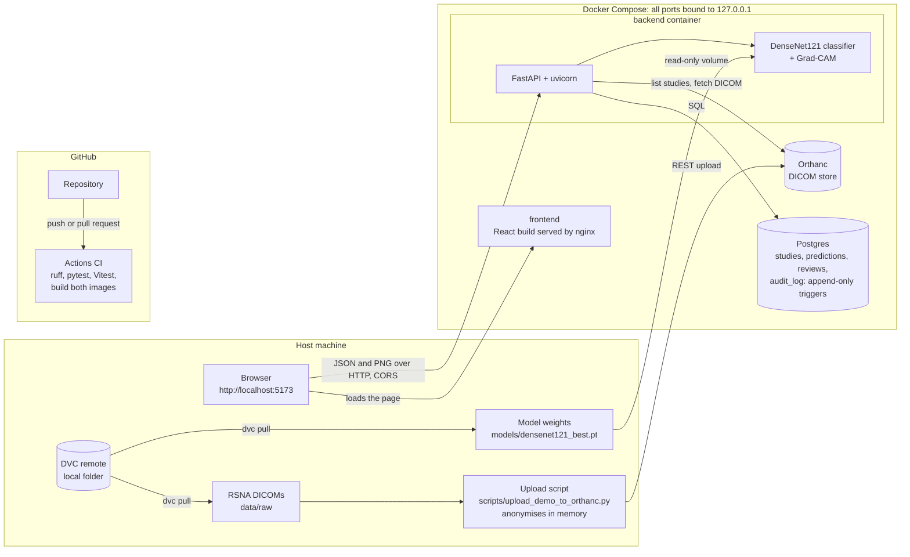
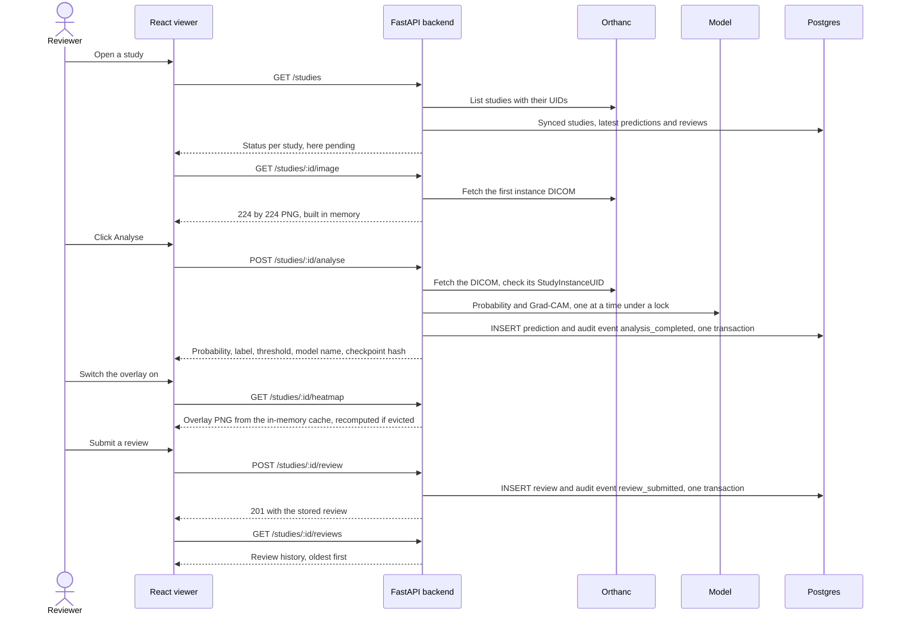

# Architecture

Educational use only. Not for clinical use.

How the parts of the system fit together, what happens during one analysis, and the
design decisions behind them. Run instructions are in the [README](../README.md); the
API is described in [api.md](api.md).

## System overview

The browser loads the static viewer from nginx and then calls the API directly; nginx
does not proxy it. DICOM files reach the backend only from Orthanc, and the backend
never writes them or derived images to disk.

## One analysis, end to end

Analysing a study that already has a prediction returns the stored one and records
`analysis_returned_cached`; `force=true` adds a new prediction instead. Earlier rows
are never changed.

## Components

| Component | Technology | Role |
| --- | --- | --- |
| Upload script | Python, pydicom, httpx | Reads the demo study list, anonymises each DICOM in memory and uploads it to Orthanc; skips studies already stored. |
| Orthanc | Orthanc 1.13.0 | DICOM store and REST API; the only source of images for the backend. |
| Backend | FastAPI, SQLAlchemy, Alembic | Syncs studies from Orthanc, runs the model, serves images and overlays, stores predictions and reviews, writes and serves the audit log. |
| Model | PyTorch DenseNet121, pytorch-grad-cam | Pneumonia-opacity probability and a Grad-CAM overlay from the last dense block; loaded once at startup, CPU only. |
| Postgres | Postgres 16 | Tables `studies`, `predictions`, `reviews`, `audit_log`; schema managed by Alembic migrations run at container start. |
| Viewer | React, Vite, TypeScript, nginx | Study list, detail with result and overlay, review form and history, read-only audit page. |
| DVC | DVC with a local remote | Versions the RSNA data and the model weights outside git; the weights are mounted into the backend read-only. |
| Docker Compose | Compose v2 | Runs Orthanc, Postgres, backend and viewer with healthchecks and start order; all ports on 127.0.0.1. |
| CI | GitHub Actions | Lint, Python and frontend tests and both image builds on every push and pull request; read-only token, actions pinned by commit SHA. |

## Design decisions

- **Anonymised uploads.** The upload script replaces PatientName with "Anonymous" and
  PatientID with a hash of the StudyInstanceUID, removes birth date and other patient
  IDs and names, blanks the referring physician, accession number, study ID, date and
  time, and caps ages above 89. This happens in memory; files on disk are not changed.
  The backend never returns patient tags, and the viewer shows studies by the last 12
  characters of their StudyInstanceUID only.
- **Threshold chosen on validation.** The decision threshold (0.480127) was chosen on
  the validation split by Youden J and is read from
  `reports/classification_metrics.json` at startup, never hard-coded. If the report
  names a different method or a value outside [0, 1], the model is not loaded: `/health`
  reports it and analysis answers 503 rather than using an unvalidated threshold. Every
  prediction stores the threshold and checkpoint hash it was made with.
- **Append-only audit log.** Database triggers reject UPDATE, DELETE and TRUNCATE on
  `audit_log`, the code has no update helper, and each audit event is written in the
  same transaction as the change it records. Reviewer free text (reason, comment) is
  kept in `reviews` only, never copied into the audit log or logs. The demo reset
  script deletes predictions, reviews and studies but appends a `demo_reset` event
  instead of touching the audit log.
- **CORS limited to http://localhost:5173.** The API allows exactly the viewer's origin,
  only GET and POST and only the Content-Type header, without credentials, configured
  in `config.yaml`. The viewer is always published on that port so the rule never has
  to widen.
- **Overlay off by default.** The Grad-CAM overlay is shown only when the reviewer
  switches it on, always with the caption "Highlights regions that influenced the
  pneumonia score. Not a diagnosis. It can also react to markers, borders and
  positioning." For a label of 0 it adds "Low score: the highlighted areas do not
  indicate findings." The heatmap is not even requested until the first switch-on.
- **One model call at a time.** Prediction and Grad-CAM run under a single lock, so
  concurrent requests queue rather than share the model. Simple and safe for a demo,
  not built for throughput.
- **Status is derived, not stored.** A study is not synced, pending or analysed
  according to what Orthanc and Postgres contain at request time, so the two can never
  disagree about a stored status field.
